# PocketStore 
Vitaliano Hugo Cordova Herrera  
Aplicaciones Web Progresivas

## Descripción del Proyecto
"PocketStore" aplicación web de una sola página que liste elementos, funcione completamente sin internet..

---

## Evidencia

1. Se creó la carpeta del proyecto y se agregaron los archivos base (`index.html` y `styles.css`) para la estructura visual.
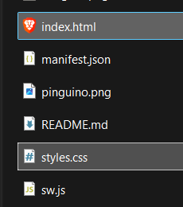
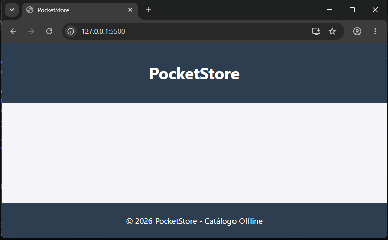

2. Se agregó el archivo `app.js`. Este se encarga de descargar la información del catálogo desde internet para mostrarla en pantalla, y también registra el *Service Worker*.
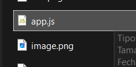
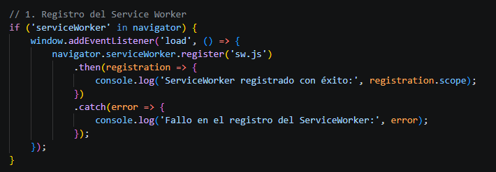

3. Se agregó el archivo `sw.js` vinculándolo con el paso anterior. Funciona en segundo plano guardando los archivos en la caché del navegador para permitir el funcionamiento sin internet.
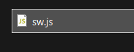
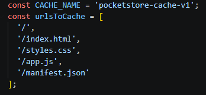

4. Se agregó el `manifest.json` junto con los iconos en la resolución requerida (192x192 y 512x512 píxeles). Esto le dice al navegador el nombre y colores de la app, habilitando la opción de instalarla. (Por alguna extraña razon el navegador identificaba 92.png y opte por cambiar el nombre del archivo y ruta)
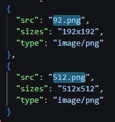
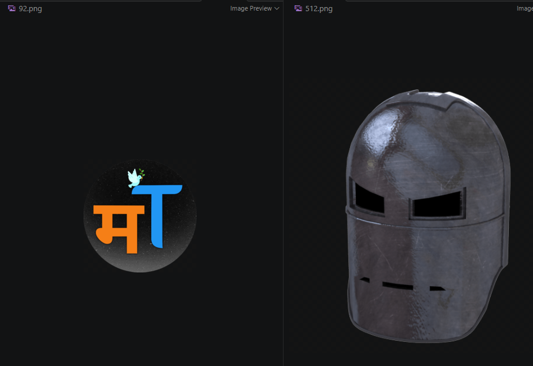

5. Se ejecutó el proyecto usando *Live Server* para cargar la información por primera vez con conexión a internet.

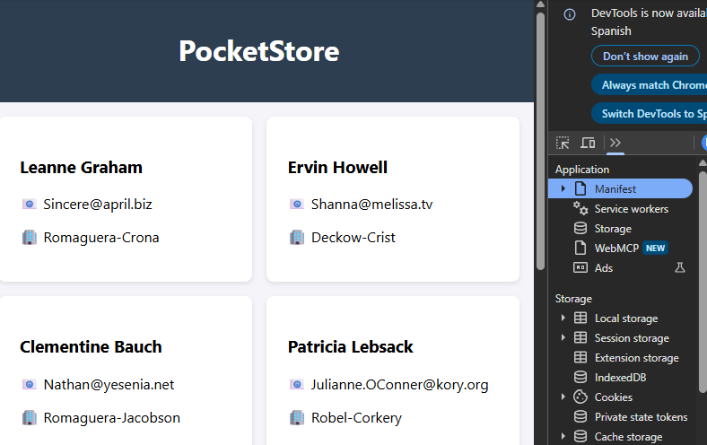

6. Se cambió el navegador a modo *Offline* (desde las herramientas de desarrollador) para comprobar que la página sigue funcionando y mostrando los datos.
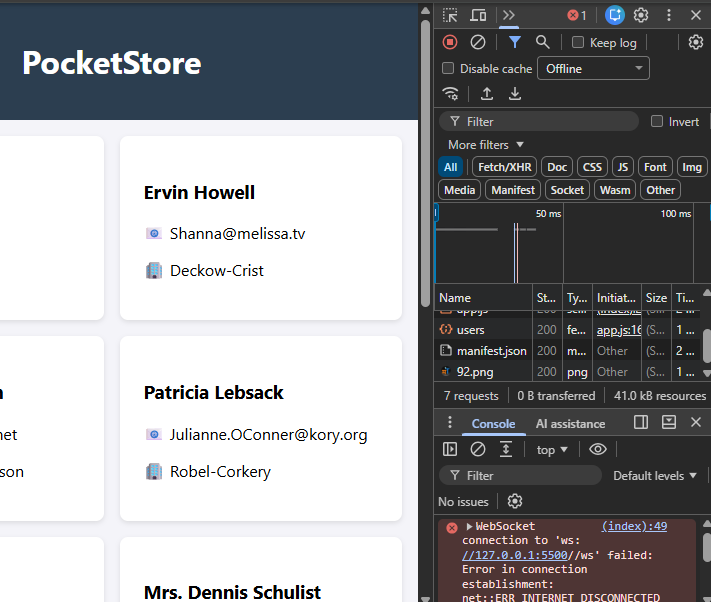

7. Se regresó a modo *Online* y se descargó la aplicación usando el botón de instalación del navegador.
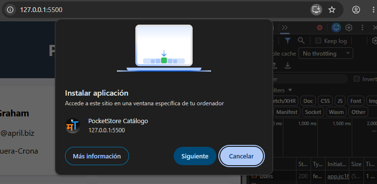

8. Se probó la aplicación instalada de manera independiente, confirmando que se abre en su propia ventana.
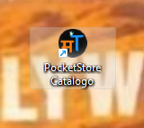
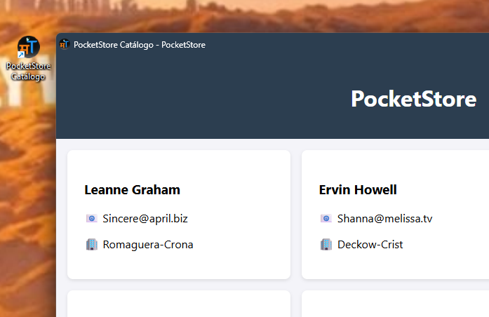

## Conclusiones
Este proyecto fue una buena práctica para entender el funcionamiento base de las PWA. Durante el desarrollo tuve algunas dificultades con el navegador para permitir la instalación, así como en la programación del almacenamiento en el `sw.js`. El principal reto fue el manejo de la caché, ya que era necesario eliminarla y desregistrar el Service Worker manualmente en cada cambio para que la información se volviera a cargar correctamente.